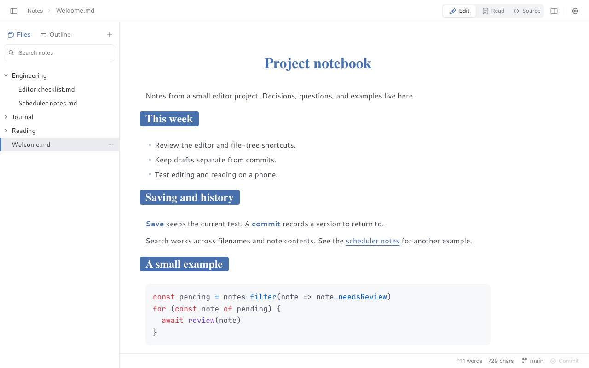
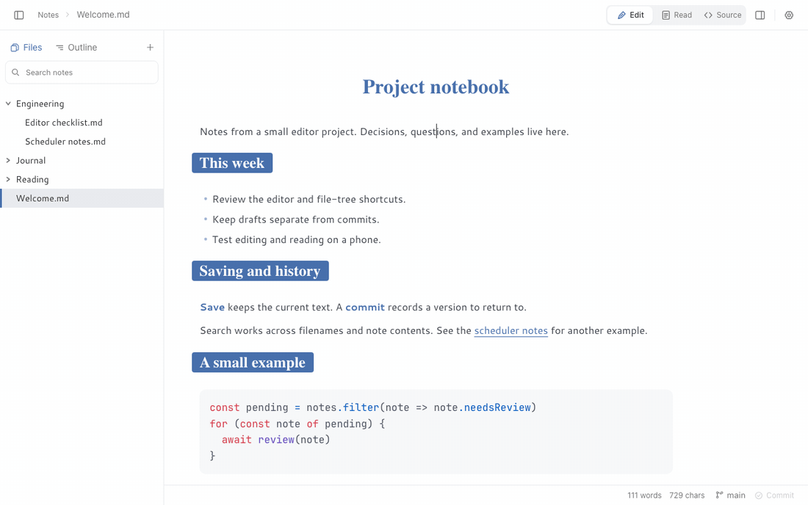

# Inkstone

A web Typora you host yourself.

Inkstone is a Markdown editor with Edit, Read, and Source views, a file tree, full-text search, and version history.



<details>
<summary>Short walkthrough: editing, Markdown source, search, and history</summary>



All notes, filenames, and commit messages shown here are demo data. To recreate these captures, see [docs/media](docs/media/README.md).

</details>

## Where notes live

| | **vault** | **github** |
|---|---|---|
| Where the notes are | A directory on this machine | The user's own GitHub repository |
| Who may sign in | One person, one shared password | Anyone with a GitHub account, each seeing only their own repository |
| What this server holds | The notes and their git repository | OAuth configuration; shared snapshots and in-memory live sessions when those features are enabled |
| Where it may be reachable from | **An intranet or Tailscale address only** | The public internet |

Set the variables for one, the other, or both; with both, GitHub sign-in is what the browser is offered.

## Using Inkstone

- **Edit** formats Markdown as you write and reveals syntax around the caret. **Read** shows the formatted note. **Source** edits the raw Markdown.
- Search matches filenames and note contents. Results show the filename, folder, and matching text.
- Click links in Read mode; use Cmd/Ctrl+click in Edit mode. Links to another note open inside Inkstone.
- History groups automatic commits into writing sessions. Manual commits show `· Commit` and their message; the first version shows `Created`. Restoring a version loads it as an unsaved draft.
- On a phone, notes open in Read mode. Editing controls are at the bottom; History, Commit, and Save all are in the More menu.

### Save, commit, and push

An unsaved note has a dot beside its title. Saving and committing are separate actions:

| Action | Vault mode | GitHub mode |
|---|---|---|
| Save | Write the note to the vault directory | Keep the changes in this browser |
| Commit | Record saved changes in the local git history | Commit saved changes to the GitHub branch |
| Push | Send local commits to the configured remote | Not needed; Commit already writes to GitHub |

**Save all** saves pending drafts, including notes you have switched away from. If a note has changed elsewhere, its draft is kept and the failure is reported. Other notes can still be saved. A note in a live session is saved when that session ends.

### Keyboard shortcuts

Use Cmd on macOS and Ctrl on Windows or Linux.

| Shortcut | Action |
|---|---|
| Cmd/Ctrl+S | Save the current note |
| Cmd/Ctrl+Shift+S | Save all pending drafts |
| Cmd/Ctrl+E | Switch between Edit and Read |
| Cmd/Ctrl+Alt+M | Toggle Markdown source |
| Cmd/Ctrl+Alt+N / F | New note / folder |
| Cmd/Ctrl+1 / 2 | Files / outline |
| Cmd/Ctrl+\\ | Toggle the file tree |
| Cmd/Ctrl+/ | Toggle history |
| Cmd/Ctrl+[ / ] | Previous / next visited note |

In the file tree, use Up/Down to move, Right to expand, Left to collapse or move to the parent, and Enter to open. In search results, use Up/Down to move, Enter to open, and Escape to return to the search field.

## Requirements

- Node.js 24 and pnpm 10 (the versions used by the Dockerfile and `packageManager`)
- vault mode: the vault directory must already be a git repository (`git init`)

## Configuration

| Variable | Default | Description |
|---|---|---|
| `SESSION_SECRET` | required | Cookie signing key |
| `VAULT_ROOT` | vault mode | Vault root directory; must be a git repository |
| `AUTH_PASSWORD` | vault mode | Login password; must differ from `SESSION_SECRET` |
| `GITHUB_CLIENT_ID` | github mode | From the GitHub App's settings page |
| `GITHUB_CLIENT_SECRET` | github mode | The App's client secret. Never the private key — that is for installation tokens, which this does not use |
| `SHARE_DIR` | optional | Where read-only share links keep their notes. Needs the GitHub pair beside it, because every share is attributed to the account that made it. Unset, sharing does not exist — no routes, no menu item. See `docs/design/sharing.md` |
| `GITHUB_APP_SLUG` | — | The name in `github.com/apps/<slug>`, so someone with no repository installed has somewhere to go |
| `INKSTONE_LIVE` | off | Set to `1` to enable live editing through invite links |
| `GITHUB_OWNER` | — | GitHub login allowed to start live sessions; required when live editing and GitHub sign-in are both enabled |
| `LISTEN_ADDR` | `127.0.0.1` | Bind address. See below before changing it |
| `PORT` | `7654` | Listen port |
| `LOG_LEVEL` | `info` | Log level (fatal/error/warn/info/debug/trace/silent) |

## Development

For vault mode, create a `.env.local` file with your own values:

```dotenv
VAULT_ROOT=/absolute/path/to/notes
AUTH_PASSWORD=replace-this-password
SESSION_SECRET=replace-with-a-different-long-random-string
```

Initialize that directory with `git init` first. Start the backend and frontend in separate terminals:

```bash
pnpm install
pnpm dev:server    # backend, 7654
pnpm dev:web       # frontend, Vite proxies to the backend
pnpm test          # unit tests
pnpm test:e2e      # end to end
```

Install the browsers used by the end-to-end suite with `pnpm exec playwright install chromium webkit`.

## Deployment

```bash
pnpm build
node --env-file-if-exists=.env.local dist/server/main.js
```

## Design docs

See `docs/design/` for the as-built architecture, editor, theming, layout, and persistence notes.

## Security

**Vault mode is for an intranet or Tailscale address.** It has one shared password and one vault, with no per-user isolation. `LISTEN_ADDR` defaults to `127.0.0.1`; use a trusted network address rather than `0.0.0.0`, and keep the vault routes off the public internet.

**GitHub mode supports public hosting.** The browser accesses the user's repository through GitHub's API. Access tokens are held in browser memory; refresh tokens use an `httpOnly` cookie. The server keeps its OAuth client secret, plus shared snapshots or live sessions when those features are enabled.

Read-only share links publish a snapshot. Live invite links allow editing one note until its owner ends the session. See [the GitHub-mode architecture](docs/design/public-route.md), [sharing](docs/design/sharing.md), and [live sessions](docs/design/live-share.md).
